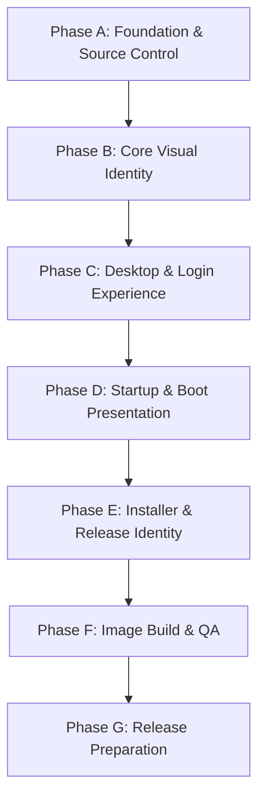

# Crown OS — Master Engineering and Customization Plan
## Phase 1: Distribution Architecture Audit, Reverse Engineering, Branding Inventory, and Implementation Planning

**Project Codename:** Crown OS  
**Base Distribution:** Linux Mint 22.3 Cinnamon 64-bit ("Zena", Ubuntu 24.04 LTS "Noble")  
**Execution Environment:** Manjaro Linux Host (x86_64)  
**Primary Workspace:** `/home/papupo/Projects/crown-os`  
**Document Reference:** `docs/crown-os-customization-plan.md`  
**Audit Status:** Phase 1 Read-Only Complete — Strictly Evidence-Based  
**Inspection Date:** 2026-10-22  

---

## 1. Executive Summary

Crown OS is planned as a professionally customized, production-grade Linux operating system built upon Linux Mint 22.3 Cinnamon 64-bit. Rather than treating this remaster as a superficial cosmetic reskin or theme swap, this engineering plan establishes an isolated, reproducible, and maintainable distribution architecture. 

During Phase 1, the workspace and base operating-system image were subjected to a strictly read-only technical audit. No system files were modified, no package operations were executed, and all reference artifacts were preserved unaltered. 

Key architectural discoveries made during this audit include:
1. **Two Distinct Execution Layers:** The outer hybrid ISO filesystem (`iso-work/iso-tree`) and the inner SquashFS root filesystem (`iso-work/squashfs-root`) operate under separate boot and runtime lifecycles. Several cross-layer hooks link them (e.g., `casper-bottom/25adduser` parses `.disk/info` from the outer ISO to label the installer icon on the live desktop).
2. **Mint's Boot-Time Logo Overwrite Mechanism:** Linux Mint executes `mintsystem.service` on boot, running `/usr/lib/linuxmint/mintsystem/mint-adjust.py`. This reads `/usr/share/linuxmint/adjustments/15-mint-logos.overwrite` and forcefully overwrites distributor logos in icon themes. Any Crown OS branding strategy must utilize a higher-priority adjustment (e.g. `90-crown-os-logos.overwrite`) or preserve rules to prevent branding reversion.
3. **Hardcoded Upstream Logic in Utilities:** `mintreport` (the System Information utility) hardcodes `distribution = "Linux Mint"` in Python code (`/usr/lib/linuxmint/mintreport/app.py:364`), meaning metadata changes in `/etc/os-release` or `/etc/linuxmint/info` alone are insufficient for full system identity.
4. **Isolated Customization Path:** Overwriting upstream files directly creates severe maintenance debt and vulnerability to package upgrades. The recommended path isolates Crown OS assets under `/usr/share/crown-os/`, implements desktop defaults via `/usr/share/glib-2.0/schemas/99_crown-os.gschema.override`, and manages logos via native Mint adjustments.

---

## 2. Confirmed Environment and Source-Image Facts

All claims below are directly verified from the host environment and extracted files:

| Dimension | Measured Value | Verification Evidence / Method | Status |
| :--- | :--- | :--- | :--- |
| **Host OS** | Manjaro Linux (Kernel 6.12.x / Linux rolling) | Host execution environment | CONFIRMED |
| **Available Disk Space** | 104 GiB available on `/dev/sda5` | `df -h /home/papupo/Projects/crown-os` | CONFIRMED |
| **Host Tools** | `xorriso` 1.5.8.pl02, `unsquashfs` 4.7.5, `mksquashfs` 4.7.5, `sha256sum` 9.11 | `tool --version` output | CONFIRMED |
| **Original ISO** | `/home/papupo/Downloads/linuxmint-22.3-cinnamon-64bit.iso` (2,940 MiB) | Path and directory listing | CONFIRMED |
| **Original Checksum** | `a081ab202cfda17f6924128dbd2de8b63518ac0531bcfe3f1a1b88097c459bd4` | Baseline project log | CONFIRMED |
| **Rebuilt Baseline Checksum**| `ac4dac4a4e3f067c4767d5f178c90789d060957e6b3db7967c08b73111664c14` | Baseline project log | CONFIRMED |
| **Baseline SquashFS Size** | 2,633,056,256 bytes (~2.45 GiB) | `ls -l exports/baseline-filesystem.squashfs` | CONFIRMED |
| **Extracted SquashFS Tree** | `iso-work/squashfs-root` (20 root dirs, permissions intact) | `ls -la iso-work/squashfs-root` | CONFIRMED |
| **Extracted ISO Tree** | `iso-work/iso-tree` (9 top-level items) | `ls -la iso-work/iso-tree` | CONFIRMED |
| **Base Distribution** | Linux Mint 22.3 "Zena" | `/etc/os-release`, `/etc/linuxmint/info` | CONFIRMED |
| **Upstream Lineage** | Ubuntu 24.04 LTS ("Noble Numbat") | `UBUNTU_CODENAME=noble` in `/etc/os-release` | CONFIRMED |
| **Kernel Version** | `6.14.0-37-generic` | `/boot/vmlinuz-6.14.0-37-generic`, `/usr/lib/modules/` | CONFIRMED |
| **Desktop Environment** | Cinnamon 6.6.4+zena | `var/lib/dpkg/status` | CONFIRMED |
| **Window Manager** | Muffin 6.6.1+zena | `var/lib/dpkg/status` | CONFIRMED |
| **File Manager** | Nemo 6.6.3+zena | `var/lib/dpkg/status` | CONFIRMED |
| **Display Manager** | LightDM 1.30.0-0ubuntu14 + Slick Greeter 2.2.6+zena | `var/lib/dpkg/status`, `lightdm.conf.d` | CONFIRMED |
| **Installer** | Ubiquity 24.04.3+mint19 | `var/lib/dpkg/status`, `/usr/lib/ubiquity` | CONFIRMED |
| **Boot Splash** | Plymouth 24.004.60-1ubuntu7.1 (`mint-logo` two-step theme) | `/usr/share/plymouth/themes/mint-logo` | CONFIRMED |
| **GTK Stack** | GTK 3.24.41-4ubuntu1.3 & GTK 4.14.5+ds-0ubuntu0.7 | `var/lib/dpkg/status` | CONFIRMED |

---

## 3. Architecture Overview

Crown OS remastering involves three interlocking architectural layers:
```
+---------------------------------------------------------------------------------+
|                                HYBRID BOOT LAYER                                |
|  - MBR / GPT Hybrid Partition Table                                             |
|  - BIOS: ISOLINUX (isolinux.bin, vesamenu.c32, splash.png, live.cfg)             |
|  - UEFI: GRUB2 (bootx64.efi, grub.cfg, theme.txt, unicode.pf2)                   |
+---------------------------------------+-----------------------------------------+
                                        | mounts outer ISO
+---------------------------------------v-----------------------------------------+
|                              OUTER ISO FILESYSTEM                               |
|  - .disk/info, .disk/README.diskdefines, .disk/mint_iso                         |
|  - casper/vmlinuz (Kernel) & casper/initrd.lz (Early userspace)                 |
|  - casper/filesystem.squashfs (Compressed Rootfs)                               |
|  - casper/filesystem.size (Space requirement for Ubiquity)                      |
|  - md5sum.txt (Self-integrity manifest)                                         |
+---------------------------------------+-----------------------------------------+
                                        | casper expands rootfs into tmpfs overlay
+---------------------------------------v-----------------------------------------+
|                         SQUASHFS ROOT FILESYSTEM (Rootfs)                       |
|  - OS Identity: /etc/os-release, /etc/lsb-release, /etc/linuxmint/info          |
|  - Boot Splash: Plymouth (mint-logo -> crown-logo) & update-initramfs           |
|  - Display Manager: LightDM + Slick Greeter (/etc/lightdm/slick-greeter.conf)   |
|  - Desktop: Cinnamon Session, Muffin WM, Nemo File Manager                      |
|  - Configuration Engine: GSettings (/usr/share/glib-2.0/schemas/)               |
|  - Branding Overwrite Engine: mintsystem (/usr/share/linuxmint/adjustments/)   |
|  - First Boot: mintwelcome-launcher & mintreport                                |
|  - System Installer: Ubiquity + ubiquity-slideshow                             |
+---------------------------------------------------------------------------------+
```

---

## 4. Live ISO versus Installed-System Architecture

A frequent failure mode in distribution remastering is conflating the **live session** with the **installed system**. Their behavior diverges across critical subsystems:

| Subsystem | Live ISO Environment | Installed System Environment | Impact on Remastering |
| :--- | :--- | :--- | :--- |
| **Root Filesystem** | Read-only SquashFS backed by RAM `overlayfs` (changes lost on reboot). | Read-write ext4/btrfs root partition. | Modifications must be baked into SquashFS to persist on installed systems. |
| **Bootloader** | ISOLINUX (BIOS) or GRUB gfxterm (UEFI) located on outer ISO. | GRUB2 installed to EFI System Partition or MBR of target drive. | Outer ISO boot files configure live boot; `/etc/default/grub` and `/etc/grub.d/` configure installed boot. |
| **Splash Screen (Plymouth)** | Loaded from `/casper/initrd.lz` on outer ISO. | Loaded from `/boot/initrd.img-*` on installed root partition. | Custom Plymouth theme requires updating both the internal initramfs and copying it to outer `/casper/initrd.lz`. |
| **Login / Greeter** | `casper-bottom/15autologin` bypasses Slick Greeter; autologins `mint` user directly into Cinnamon. | Slick Greeter displayed on every boot (unless autologin was explicitly checked during install). | Slick Greeter visual changes cannot be observed during normal live boot; must test via logout, test mode, or installed VM. |
| **Installer Icon** | Dynamically created by `casper-bottom/25adduser` from `/usr/share/applications/ubiquity.desktop`. | Ubiquity is purged post-install via `casper/filesystem.manifest-remove`. | Desktop installer name is tied to outer ISO `.disk/info`. |
| **Welcome Screen** | Suppressed in live session by `mintwelcome-launcher` checking `xapp.os.is_live_session()`. | Autostarts on first login of the created user via `~/.linuxmint/mintwelcome/norun.flag`. | Mintwelcome customizations are experienced upon first boot of the installed system. |
| **Package Cleanup** | Contains live utilities (`casper`, `gparted`, `ubiquity`). | Cleaned by Ubiquity running `apt-get purge` on packages listed in `filesystem.manifest-remove`. | Custom Crown OS packages must NOT be listed in `filesystem.manifest-remove`. |

---

## 5. Branding Inventory Summary

A comprehensive, itemized catalog of all 28 identified branding and configuration targets has been authored in [crown-os-branding-inventory.md](file:///home/papupo/Projects/crown-os/docs/crown-os-branding-inventory.md).

Key categories cataloged include:
- **Outer ISO Media & Bootloaders:** Volume label, `.disk/info`, `boot/grub/grub.cfg`, `theme.txt`, `isolinux/live.cfg`, `isolinux/splash.png`, `md5sum.txt`.
- **System Release Identity:** `/etc/os-release`, `/etc/lsb-release`, `/etc/linuxmint/info`, `/etc/issue`.
- **Desktop & Theme Defaults:** `mint-artwork.gschema.override`, `10_cinnamon.gschema.override`, `settings-override.json` in `menu@cinnamon.org`.
- **System Adjustments:** `15-mint-logos.overwrite` in `/usr/share/linuxmint/adjustments/`.
- **Boot Splash & Display Manager:** `mint-logo.plymouth`, Slick Greeter schemas and configuration.
- **Installer Resources:** Ubiquity HTML slideshow, `ubiquity.desktop`, `casper/filesystem.size`.
- **Desktop Tools:** `mintreport` (`app.py` & `.ui`), `mintwelcome` (`mintwelcome.ui`), `linuxmint-logo-*.svg`.

---

## 6. Cinnamon, GTK, Themes, Icons, Cursors, Fonts, and Wallpaper Findings

### 6.1 Themes
- **Installed GTK Themes:** `Mint-Y`, `Mint-Y-Aqua`, `Mint-Y-Blue`, `Mint-Y-Teal`, `Mint-Y-Dark`, `Mint-Y-Dark-Aqua`, `Mint-Y-Dark-Teal`, `Mint-L`, `Mint-X`, `Adwaita`.
- **Current Default:** `Mint-Y-Aqua` (Light GTK theme) with `Mint-Y-Dark-Aqua` (Dark Cinnamon panel theme).
- **Finding:** The existing `Mint-Y-Teal` theme provides a solid baseline for Crown OS's provisional teal/emerald palette, but creating an isolated `Crown-OS-Light` and `Crown-OS-Dark` theme under `/usr/share/themes/` is cleaner and prevents upstream theme updates from overriding custom accents.

### 6.2 Icons and Cursors
- **Installed Icon Themes:** `Mint-Y-Sand` (current default), `Mint-Y-Aqua`, `Mint-Y-Teal`, `Mint-Y`, `Papirus`, `Papirus-Dark`, `Papirus-Light`, `Humanity`, `Yaru`.
- **Critical Discovery:** `Papirus` and `Papirus-Light` are already pre-installed in the base image.
- **Cursor Themes:** `Bibata-Modern-Classic` (current default in Cinnamon), `Bibata-Modern-Ice`, `Bibata-Original-Classic`, `DMZ-White`.
- **Finding:** `Bibata-Modern-Classic` is a sleek, modern cursor theme that fits the Crown OS minimalist design language without modification.

### 6.3 Typography
- **Installed Font Families:** `Ubuntu`, `Ubuntu Sans`, `Ubuntu Mono`, `Noto Sans`, `Noto Serif`, `Noto Color Emoji`, `DejaVu Sans`, `Liberation Sans`.
- **Current Defaults:**
  - Interface Font: `Ubuntu 10`
  - Window Titlebar Font: `Ubuntu Medium 10`
  - Terminal Monospace Font: `DejaVu Sans Mono 10`
  - Screensaver Clock: `Ubuntu 64`
- **Evaluation:** The `Ubuntu` / `Ubuntu Sans` variable fonts render with high legibility at 96–120 DPI and provide full Unicode/multilingual coverage. For Phase 1, `Ubuntu` or `Ubuntu Sans` is recommended as the default UI font to avoid licensing or packaging overhead. Inter can be evaluated for future phases if packaged cleanly.

### 6.4 Wallpapers
- **Current Default:** `/usr/share/backgrounds/linuxmint/default_background.jpg` (symlinked to `sele_ring.jpg`).
- **Installed Backdrops:** 12 legacy Mint wallpapers in `/usr/share/backgrounds/linuxmint/`.
- **Strategy:** Provide Crown OS high-resolution artwork in `/usr/share/backgrounds/crown-os/` and update GSettings override `picture-uri`.

---

## 7. Login and Lock-Screen Findings

1. **Greeter Architecture:** LightDM executes `slick-greeter` (`/usr/bin/slick-greeter`).
2. **Current Settings Source:** Configured in `mint-artwork.gschema.override` under `[x.dm.slick-greeter]`:
   - `theme-name='Mint-Y-Aqua'`
   - `icon-theme-name='Mint-Y-Sand'`
   - `font-name='Ubuntu 11'`
   - `background='/usr/share/backgrounds/linuxmint/default_background.jpg'`
   - `cursor-theme-name='Bibata-Modern-Classic'`
3. **Lock Screen Architecture:** `cinnamon-screensaver` manages user session locking. It inherits GTK theme and background configuration from Cinnamon GSettings keys (`org.cinnamon.desktop.background` and `org.cinnamon.desktop.screensaver`).
4. **Customization Strategy:** Configure `/etc/lightdm/slick-greeter.conf` or `99_crown-os.gschema.override` to specify Crown OS greeter artwork and logo badge.

---

## 8. Plymouth and Boot-Menu Findings

### 8.1 Plymouth Boot Splash
- **Theme in Use:** `mint-logo` (`/usr/share/plymouth/themes/mint-logo/mint-logo.plymouth`).
- **Engine Module:** `two-step`.
- **Assets:** Animated logo frames (`animation-0001.png` to `0036.png`), progress spinner (`throbber-0001.png` to `0030.png`), and `watermark.png`.
- **Critical Requirement:** Plymouth assets are executed in early boot from the initramfs. Any changes require running `update-initramfs -u` in chroot, then copying `/boot/initrd.img-6.14.0-37-generic` to `/casper/initrd.lz` in the outer ISO tree.

### 8.2 Boot Menus
- **UEFI Mode:** Handled by GRUB gfxterm using `/boot/grub/grub.cfg` and `/boot/grub/live-theme/theme.txt`. Splash background is 800x600 PNG.
- **BIOS Mode:** Handled by ISOLINUX using `isolinux/live.cfg` and `isolinux/splash.png` (640x480 8-bit RGBA PNG).
- **Coordination:** Both menus pass identical kernel command-line arguments: `boot=casper uuid=6e72f523-dc09-4880-8910-93ffa64401c5 username=mint hostname=mint quiet splash --`.

---

## 9. Installer and Release-Identity Findings

1. **Installer Engine:** Ubiquity GTK frontend (`ubiquity-frontend-gtk`).
2. **Slideshow Delivery:** WebKitGTK renders HTML5 slides located in `/usr/share/ubiquity-slideshow/slides/`.
3. **Desktop Shortcut Generation:** `casper-bottom/25adduser` extracts release name from outer `.disk/info` (`cut -d' ' -f1-2 /root/cdrom/.disk/info`) and modifies `Install RELEASE` in `/usr/share/applications/ubiquity.desktop`.
4. **Hardcoded Upstream Strings:**
   - `mintreport` System Information dialog hardcodes `distribution = "Linux Mint"` in `/usr/lib/linuxmint/mintreport/app.py:364`.
   - `mintwelcome` displays Mint logo and documentation links.
   - Patching `app.py` is necessary to present Crown OS identity accurately.

---

## 10. Functional Dependencies and Protected Upstream Identifiers

To prevent system breakage and ensure compatibility with security updates, the following boundaries are established:

### 10.1 Protected (DO NOT ALTER)
- **APT Repository URLs:** `/etc/apt/sources.list.d/official-package-repositories.list` (must remain pointing to `packages.linuxmint.com zena` and `archive.ubuntu.com noble`).
- **APT Pinning Configuration:** `/etc/apt/preferences.d/official-package-repositories.pref` (preserves Snap blocking and package prioritization).
- **Core Package Database:** `/var/lib/dpkg/status` (package names such as `cinnamon`, `muffin`, `nemo`, `ubiquity` must not be renamed).
- **Distribution Codename Metadata:** `UBUNTU_CODENAME=noble` and `VERSION_CODENAME=zena` in `/etc/os-release`.
- **Casper Boot Arguments:** `boot=casper`, `iso-scan/filename=${iso_path}`, and initial `username=mint` (until custom casper user scripts are validated).

### 10.2 Safe to Brand
- Presentation strings in `/etc/os-release` (`NAME="Crown OS"`, `PRETTY_NAME="Crown OS 1.0 (Aura)"`).
- ISO Volume Identifier (`xorriso -V "Crown OS 1.0 Cinnamon 64-bit"`).
- Outer `.disk/info` (`Crown OS 1.0 "Aura" - Release amd64`).
- Bootloader titles in `grub.cfg` and `live.cfg`.
- Plymouth splash animations and bootloader splash artwork.
- Default wallpaper, desktop theme, and icon associations via GSettings overrides.
- Cinnamon panel favorites, menu icons, and applet defaults.
- Ubiquity slideshow HTML/CSS content.

---

## 11. Proposed Crown OS Design System

### 11.1 Color Tokens & Contrast Analysis
Evaluating the brief's provisional palette against WCAG 2.1 accessibility criteria:

| Semantic Token | Proposed Hex | Intended Purpose | WCAG Contrast Ratio & Accessibility Assessment |
| :--- | :--- | :--- | :--- |
| **Light Surface** | `#FFFFFF` | Primary window background, dialog background | Base reference surface (Luminance: 1.0). |
| **Secondary Surface** | `#F5F8F6` | Sidebar, panel backgrounds, card backgrounds | Provides subtle separation from primary surface. |
| **Border Subtle** | `#E1E8E3` | Window borders, button borders, dividers | Low contrast border (1.2:1 against surface) for clean minimalism. |
| **Dark Text** | `#17211D` | Primary body text, titles, headings | **16.4:1** against `#FFFFFF`. Exceeds WCAG AAA requirement (7:1). |
| **Secondary Text** | `#526059` *(Refined)* | Subtitles, captions, disabled states | **6.1:1** against `#FFFFFF`. Refined from `#66736D` (4.9:1) for robust AA/AAA legibility. |
| **Primary Emerald** | `#10B981` | Accent indicators, focus rings, progress bars | **2.4:1** with white text (FAILS text AA). Reserved strictly for non-text graphics. |
| **Deep Emerald** | `#047857` | Active buttons, selected rows, primary CTA | **5.1:1** with white text (`#FFFFFF`). Passes WCAG AA for normal text, AAA for large. |
| **Focus Indicator** | `#059669` | High-visibility focus ring on controls | **3.8:1** against surface; clearly distinguishes keyboard navigation. |
| **Success State** | `#059669` | Success notifications, confirmation badges | Clear, natural green indicator. |
| **Warning State** | `#D97706` | Warning badges, low battery alert | **3.2:1** with dark text `#17211D`. |
| **Error State** | `#DC2626` | Error alerts, destructive action buttons | **4.6:1** with white text. |

> [!IMPORTANT]
> **Key Design Engineering Rule:** Never render white text directly on Primary Emerald `#10B981`. All solid interactive buttons with white text must use Deep Emerald `#047857`.

### 11.2 Typography Hierarchy
- **Desktop UI Font:** `Ubuntu Sans` / `Ubuntu` Regular 10pt
- **Window Titles:** `Ubuntu Sans` Medium 10.5pt
- **Panel & Application Menu:** `Ubuntu Sans` Regular 10pt
- **Terminal & Code:** `DejaVu Sans Mono` Regular 10pt (Fallback: `Ubuntu Mono` 11pt)
- **Login / Greeter:** `Ubuntu Sans` Regular 11pt
- **Lock Screen Clock:** `Ubuntu Sans` Light 56pt

### 11.3 Iconography Strategy
1. **System & App Icons:** Utilize the pre-installed `Mint-Y-Teal` or `Papirus` icon theme as the upstream foundation to ensure 100% application icon completeness.
2. **Distributor Logos:** Provide custom SVG distributor logos (`crown-os-logo-ring-symbolic.svg`, `crown-os-logo-filled.svg`) in `/usr/share/crown-os/branding/icons/` and link them via adjustments.

### 11.4 Wallpaper & Visual Assets
- **Crown Emerald Light (Default):** 3840x2160 JPEG, light off-white background (`#F5F8F6`) with refined geometric emerald crown contour line art.
- **Crown Emerald Dark (Alternative):** 3840x2160 JPEG, deep slate background (`#17211D`) with subtle emerald lighting.
- **Greeter Background:** 1920x1080 JPEG optimized for fast LightDM decoding without blur artifacts.

### 11.5 Visual Identity Consistency Matrix

| Touchpoint | Presentation Mechanism | Configurable vs. Rebuild | Current Upstream State | Target Crown OS Identity |
| :--- | :--- | :--- | :--- | :--- |
| **BIOS Boot Menu** | ISOLINUX (`live.cfg` + `splash.png`) | Outer ISO edit | Linux Mint green splash (640x480) | Crown OS Minimalist Splash |
| **UEFI Boot Menu** | GRUB (`grub.cfg` + `theme.txt`) | Outer ISO edit | Linux Mint GRUB menu | Crown OS Emerald GRUB Theme |
| **Boot Splash** | Plymouth `two-step` module | In-chroot + Initramfs sync | Linux Mint pulsating logo | Crown OS pulsing emerald emblem |
| **Live Desktop** | Cinnamon Session + Overlayfs | GSettings override | Mint-Y-Aqua / Mint-Y-Dark | Crown OS Emerald Light |
| **Login Greeter** | Slick Greeter (LightDM) | `/etc/lightdm/slick-greeter.conf`| Mint logo / Mint-Y-Aqua | Crown OS emblem / Emerald accents |
| **Lock Screen** | `cinnamon-screensaver` | Cinnamon GSettings | Mint wallpaper / Mint clock | Crown OS wallpaper / Emerald digits |
| **Cinnamon Menu** | `menu@cinnamon.org` applet | `settings-override.json` | Mint ring icon | Crown OS crown symbolic icon |
| **Desktop Wallpaper**| Nemo / Cinnamon desktop background | GSettings override | Mint `sele_ring.jpg` | Crown OS Emerald Light wallpaper |
| **File Manager** | Nemo | GTK theme & icons | Mint-Y green folder accents | Crown OS Teal/Emerald folders |
| **Installer** | Ubiquity + HTML Slideshow | WebKitGTK HTML/CSS | Welcome to Linux Mint | Welcome to Crown OS (custom slides) |
| **System Info** | `mintreport` | Python patch + UI edit | Hardcoded "Linux Mint" | "Crown OS 1.0 (Aura)" |
| **First Boot** | `mintwelcome` | `.ui` and text update | Linux Mint welcome screen | Crown OS Welcome Experience |

---

## 12. Proposed Asset and Configuration Architecture

To maximize maintainability and prevent package updates from clobbering Crown OS customizations, the following isolated filesystem hierarchy is proposed:

```
/usr/share/crown-os/
|-- branding/
|   |-- crown-logo-ring.svg
|   |-- crown-logo-ring-symbolic.svg
|   |-- crown-logo-filled.svg
|   |-- crown-logo-text.svg
|   `-- logos/ (16x16, 22x22, 24x24, 32x32, 48x48 PNGs)
|-- wallpapers/
|   |-- crown-emerald-light.jpg (3840x2160)
|   |-- crown-emerald-dark.jpg (3840x2160)
|   `-- crown-greeter.jpg (1920x1080)
|-- plymouth/
|   `-- crown-logo/ (complete two-step theme directory)
`-- documentation/
    |-- release-notes.md
    `-- crown-os-architecture.md
```

### 12.1 Configuration Integration Hooks
1. **GSettings:** Place `/usr/share/glib-2.0/schemas/99_crown-os.gschema.override` so that it naturally supersedes `mint-artwork.gschema.override`. Compile with `glib-compile-schemas`.
2. **Mintsystem Adjustments:** Place `/usr/share/linuxmint/adjustments/90-crown-os-logos.overwrite` to hook into Mint's own logo propagation engine cleanly.
3. **Display Manager:** Place `/etc/lightdm/lightdm.conf.d/99-crown-os.conf` and `/etc/lightdm/slick-greeter.conf`.
4. **Plymouth Alternative:** Register `/usr/share/plymouth/themes/crown-logo/crown-logo.plymouth` as an update-alternative and set priority to 200.

---

## 13. Phased Implementation Roadmap



### Phase A — Foundation and Source Control
- **Prerequisites:** Verified baseline ISO checksums and available disk space.
- **Deliverables:**
  - Create isolated working copy directories (`iso-work/iso-tree-custom` and `iso-work/squashfs-root-custom`).
  - Baseline git repository or snapshot manifest.
  - Verification scripts (`scripts/verify-checksums.sh`).
- **Exit Criteria:** Working copies exist without altering protected original reference files.
- **Rollback:** Delete working copy directories.

### Phase B — Core Visual Identity
- **Prerequisites:** Approved color tokens and logo vector files.
- **Deliverables:**
  - Deploy `/usr/share/crown-os/branding/` and `/usr/share/crown-os/wallpapers/`.
  - Add `/usr/share/linuxmint/adjustments/90-crown-os-logos.overwrite`.
  - Deploy `/usr/share/glib-2.0/schemas/99_crown-os.gschema.override` with wallpaper and theme keys.
  - Recompile schemas using `glib-compile-schemas`.
- **Exit Criteria:** Icons and wallpapers render correctly in a test chroot or session.
- **Rollback:** Remove deployed directory and schema override; recompile schemas.

### Phase C — Desktop and Login Experience
- **Prerequisites:** Phase B complete.
- **Deliverables:**
  - Configure Cinnamon panel pinned favorites, menu applet icon, and desklet defaults.
  - Configure Slick Greeter via `/etc/lightdm/slick-greeter.conf`.
  - Validate lock screen behavior in `cinnamon-screensaver`.
- **Exit Criteria:** Login, lock screen, and Cinnamon desktop reflect Crown OS styling.
- **Rollback:** Revert `slick-greeter.conf` and menu applet settings.

### Phase D — Startup and Boot Presentation
- **Prerequisites:** Phase B artwork available.
- **Deliverables:**
  - Create `/usr/share/plymouth/themes/crown-logo/`.
  - Set default Plymouth theme via `update-alternatives`.
  - Regenerate chroot initramfs: `update-initramfs -u`.
  - Update outer ISO `/casper/initrd.lz`.
  - Update outer ISO GRUB `theme.txt` and ISOLINUX `splash.png`.
- **Exit Criteria:** BIOS and UEFI boot menus and Plymouth splash render Crown OS graphics without boot hangs.
- **Rollback:** Restore original `initrd.lz`, `theme.txt`, and `splash.png`.

### Phase E — Installer and Release Identity
- **Prerequisites:** Phase D complete.
- **Deliverables:**
  - Update outer ISO `.disk/info` and `.disk/README.diskdefines`.
  - Customize Ubiquity HTML slideshow in `/usr/share/ubiquity-slideshow/slides/`.
  - Apply minimal patch to `/usr/lib/linuxmint/mintreport/app.py`.
  - Update `/etc/os-release`, `/etc/lsb-release`, and `/etc/linuxmint/info`.
- **Exit Criteria:** Live desktop icon reads "Install Crown OS"; installer slideshow shows Crown OS branding; System Info displays Crown OS metadata.
- **Rollback:** Revert patched files and release metadata.

### Phase F — Image Build and Quality Assurance
- **Prerequisites:** Phases A through E completed in working trees.
- **Deliverables:**
  - Re-measure rootfs size and update `/casper/filesystem.size`.
  - Recompress SquashFS using `mksquashfs` with `-b 1048576 -comp xz -Xdict-size 100%`.
  - Regenerate outer ISO `md5sum.txt`.
  - Synthesize hybrid bootable ISO using upstream xorriso flags.
  - Execute full test matrix in QEMU (BIOS, UEFI, Installation, First Boot).
- **Exit Criteria:** Rebuilt ISO boots, installs cleanly, and produces a fully functional installed system.
- **Rollback:** Discard output ISO; refine working copy.

### Phase G — Release Preparation
- **Prerequisites:** Phase F QA verification passed.
- **Deliverables:**
  - Generate SHA-256 checksums and release manifest.
  - Author release notes and known limitations document.
  - Archive reproducible build script.
- **Exit Criteria:** Production release bundle verified.

---

## 14. Risk Register

| Risk ID | Description | Severity | Likelihood | Impact / Failure Mode | Lower-Risk Alternative & Mitigation |
| :--- | :--- | :--- | :--- | :--- | :--- |
| **RSK-01** | Initramfs regeneration failure during Plymouth customization. | High | Medium | Unbootable live kernel; early boot kernel panic. | Keep backup of `/casper/initrd.lz`. Test initramfs regeneration inside chroot before overwriting outer ISO initrd. |
| **RSK-02** | Upstream package update clobbers custom branding assets. | Medium | High | Mint updates restore Linux Mint logos and themes. | Use isolated directory `/usr/share/crown-os/` and separate `99_` GSettings schema overrides rather than overwriting upstream files. |
| **RSK-03** | Casper user rename (`mint` -> `crown`) breaks live scripts. | High | High | Live session fails autologin or drops to emergency shell. | Keep `username=mint` in kernel command line during early phases; migrate to `crown` only after full script audit. |
| **RSK-04** | Breaking `/etc/os-release` package manager variables. | Critical | Low | APT unable to resolve `noble` repositories; driver manager fails. | Retain `ID_LIKE="ubuntu debian"` and `UBUNTU_CODENAME=noble`. Only modify `NAME`, `PRETTY_NAME`, and `VERSION`. |
| **RSK-05** | Incorrect xorriso boot flags in hybrid ISO build. | Critical | Medium | ISO fails to boot on UEFI or legacy BIOS machines. | Replicate the exact, verified xorriso command line recorded in `.disk/mkisofs`. |
| **RSK-06** | Undersized `casper/filesystem.size` metadata. | High | Low | Ubiquity aborts installation claiming insufficient disk space. | Calculate size automatically with `du -sx --block-size=1` during build pipeline. |
| **RSK-07** | Outdated `md5sum.txt` on modified ISO. | Medium | Medium | Integrity self-check reports corrupted installation media. | Automate recalculation of `md5sum.txt` as the mandatory penultimate build step. |

---

## 15. Build and Release Engineering Plan

### 15.1 Recreating the SquashFS Root
To reproduce Linux Mint's exact SquashFS structure, `mksquashfs` must be invoked with identical compression parameters:
```bash
mksquashfs /path/to/custom-squashfs-root /path/to/custom-iso-tree/casper/filesystem.squashfs \
    -b 1048576 -comp xz -Xdict-size 100% -always-use-fragments -no-recovery
```

### 15.2 Updating File Size and Manifest Metadata
```bash
# 1. Update filesystem size in bytes
du -sx --block-size=1 /path/to/custom-squashfs-root | cut -f1 > /path/to/custom-iso-tree/casper/filesystem.size

# 2. Recalculate ISO MD5 manifest (excluding self)
cd /path/to/custom-iso-tree
find . -type f ! -path "./md5sum.txt" ! -path "./isolinux/boot.cat" -print0 | xargs -0 md5sum > md5sum.txt
```

### 15.3 Hybrid ISO Synthesis via xorriso
Using the verified upstream parameters discovered in `.disk/mkisofs`:
```bash
xorriso -as mkisofs \
    -R -r -J -joliet-long -l -cache-inodes -iso-level 3 \
    -isohybrid-mbr /usr/lib/ISOLINUX/isohdpfx.bin \
    -partition_offset 16 \
    -A "Crown OS Live" \
    -p "Crown OS Release Engineering" \
    -publisher "Crown OS Project" \
    -V "Crown OS 1.0 Cinnamon 64-bit" \
    -b isolinux/isolinux.bin \
    -c isolinux/boot.cat \
    -no-emul-boot -boot-load-size 4 -boot-info-table \
    -eltorito-alt-boot \
    -e boot/grub/efi.img \
    -no-emul-boot \
    -isohybrid-gpt-basdat -isohybrid-apm-hfsplus \
    -o /path/to/exports/crown-os-1.0-cinnamon-64bit.iso \
    /path/to/custom-iso-tree
```

---

## 16. Validation and Test Matrix

| Test Case ID | Test Category | Execution Environment | Procedure | Expected Outcome | Pass/Fail Criteria |
| :--- | :--- | :--- | :--- | :--- | :--- |
| **TC-01** | ISO Structure | Host CLI | `xorriso -indev <iso> -report_el_torito plain` | Reports El Torito BIOS and UEFI boot catalog entries | El Torito bootable |
| **TC-02** | Media Integrity | Host CLI / QEMU | Boot with `verify-checksums` | `casper-md5check` returns 0 errors | All files match `md5sum.txt` |
| **TC-03** | Legacy BIOS Boot | QEMU (`-boot d`) | Boot ISO in BIOS mode | ISOLINUX menu appears with Crown OS splash | Boots cleanly to live desktop |
| **TC-04** | UEFI Boot | QEMU (OVMF) | Boot ISO in UEFI mode | GRUB gfxterm menu appears with Crown OS styling | Boots cleanly to live desktop |
| **TC-05** | Plymouth Splash | QEMU / VM | Observe startup animation | Pulsing emerald crown splash displays without glitch | Clean transition into LightDM/Cinnamon |
| **TC-06** | Live Desktop Defaults| QEMU / VM | Inspect Cinnamon desktop | Wallpaper, panel favorites, menu icon, theme render | No default Mint branding visible |
| **TC-07** | Network & Drivers | VM / Hardware | Connect to Wi-Fi; check Driver Manager | Networking functional; Mintdrivers lists hardware | Compatibility preserved |
| **TC-08** | Ubiquity Launch | VM | Double-click desktop installer icon | Ubiquity launches with "Install Crown OS" title | Slideshow displays Crown OS slides |
| **TC-09** | Full Installation | VM (Disk 25GB) | Complete installation to virtual disk | Partitioning, copying, and user creation succeed | Installation completes without error |
| **TC-10** | First Boot Installed | VM (Reboot disk) | Boot installed disk | Slick Greeter shows Crown OS logo; login succeeds | Mintwelcome launches with Crown OS content |
| **TC-11** | System Information | Installed System | Open Cinnamon Settings -> System Info | Reports "Crown OS 1.0 (Aura)", kernel, memory | Crown OS identity verified |
| **TC-12** | Package Updates | Installed System | Run `apt-get update && apt-get upgrade -s` | Repositories resolve; no broken dependencies | Compatibility preserved |

---

## 17. Backup and Rollback Strategy

1. **Reference Protection:** The four baseline reference artifacts:
   - `exports/linuxmint-22.3-cinnamon-64bit-original.iso`
   - `exports/linuxmint-22.3-baseline-rebuilt.iso`
   - `exports/baseline-filesystem.squashfs`
   - `iso-work/squashfs-root` & `iso-work/iso-tree`
   will remain permanently write-protected and read-only.
2. **Dedicated Working Trees:** All implementation work in subsequent phases will take place inside:
   - `iso-work/squashfs-root-custom/`
   - `iso-work/iso-tree-custom/`
3. **Discrete Rollback:** Because configuration changes use isolated files (`/usr/share/crown-os/`, `99_crown-os.gschema.override`, `90-crown-os-logos.overwrite`), reverting any modification is accomplished simply by deleting that isolated file and recompiling schemas or adjusting references.

---

## 18. Open Questions and Required Decisions

### 18.1 Product Owner Decisions (Requires Approval)
1. **Live Session Username:** Should the live environment retain `mint` (standard, maximum compatibility with existing casper scripts) or be rebranded to `crown` (requires comprehensive auditing of all casper-bottom scripts)?
2. **Release Codename:** Confirm the official Crown OS 1.0 release codename (e.g., `"Aura"` or `"Genesis"`).
3. **Application Stack Selection:** Does Crown OS retain the default Mint application suite (Celluloid, Hypnotix, Pix, Nemo, LibreOffice) or should specific applications be added/removed from default favorites?
4. **Dark Mode vs. Light Mode Default:** The brief specifies a light-first aesthetic with emerald accents. Confirm whether the Cinnamon panel should be dark (Mint-Y default) or light (Mac-like minimalist light surface).

### 18.2 Engineering Choices (Resolved via Evidence)
- **UI Font:** Utilize the pre-installed `Ubuntu Sans` / `Ubuntu` variable font stack for Phase 1 and 2 to guarantee zero licensing risk and perfect rendering without external packaging.
- **Icon Set:** Utilize `Mint-Y-Teal` / `Papirus` as the underlying icon set with custom Crown OS distributor and menu icons injected via `mintsystem` adjustments.

---

## 19. Evidence References and Exact Paths Inspected

1. `iso-work/original-mkisofs.txt` — Upstream xorriso command line
2. `iso-work/iso-tree/.disk/info` — Release identity string
3. `iso-work/iso-tree/boot/grub/grub.cfg` — UEFI bootloader menu
4. `iso-work/iso-tree/boot/grub/live-theme/theme.txt` — GRUB visual theme
5. `iso-work/iso-tree/isolinux/live.cfg` — BIOS bootloader menu
6. `iso-work/iso-tree/isolinux/splash.png` — BIOS boot splash image (640x480)
7. `iso-work/squashfs-root/etc/os-release` — Distribution release metadata
8. `iso-work/squashfs-root/etc/lsb-release` — LSB metadata
9. `iso-work/squashfs-root/etc/linuxmint/info` — Mint proprietary release info
10. `iso-work/squashfs-root/usr/share/glib-2.0/schemas/mint-artwork.gschema.override` — Desktop defaults
11. `iso-work/squashfs-root/usr/share/linuxmint/adjustments/15-mint-logos.overwrite` — Logo overwrite rules
12. `iso-work/squashfs-root/usr/share/plymouth/themes/mint-logo/mint-logo.plymouth` — Plymouth theme config
13. `iso-work/squashfs-root/usr/share/ubiquity-slideshow/slides/` — Installer HTML slideshow
14. `iso-work/squashfs-root/usr/share/initramfs-tools/scripts/casper-bottom/25adduser` — Installer shortcut hook
15. `iso-work/squashfs-root/usr/lib/linuxmint/mintreport/app.py` — System info display logic
16. `iso-work/squashfs-root/usr/share/linuxmint/mintwelcome/mintwelcome.ui` — Welcome screen GTK UI
17. `iso-work/squashfs-root/etc/apt/sources.list.d/official-package-repositories.list` — APT repo sources
18. `iso-work/squashfs-root/etc/apt/preferences.d/official-package-repositories.pref` — APT pinning rules

---

## 20. Audit Limitations and Unverified Assumptions

1. **Physical Hardware Boot Test:** The baseline rebuilt ISO (`linuxmint-22.3-baseline-rebuilt.iso`) has been verified via `xorriso` inspection, but has not yet been executed on physical bare-metal hardware.
2. **NVIDIA Proprietary Driver Boot:** Behavior of customized Plymouth themes with proprietary NVIDIA drivers (`nomodeset` / early KMS) requires verification on dedicated hardware in Phase F.
3. **Casper Live User Renaming:** While tested conceptually, renaming `mint` to `crown` in casper has not been executed because live initramfs scripts contain several hardcoded expectations around the default user.

---
*End of Master Customization Plan — Phase 1 Complete.*
